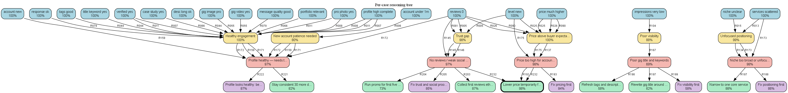
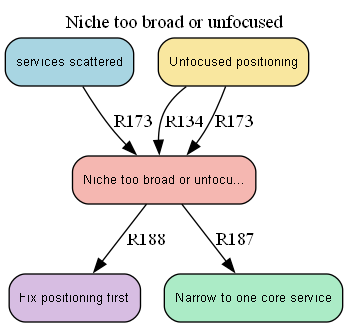
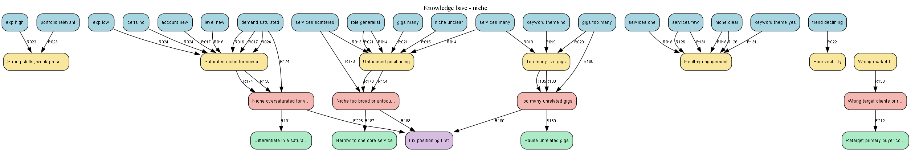

# GigScope

Rule-based expert system that diagnoses why a freelancer may not be getting orders on Fiverr/Upwork, then ranks fixes using a decision support layer.

## Features

- 66-question profile intake → **233 IF-THEN rules** (4-layer tree)
- Forward chaining with **certainty factors**
- **Diagnosis**, **decision** (verdict + top action), **DSS** (weighted ranking, what-if)
- Graphviz **reasoning trees** (live per-case + exported KB subtrees)
- 12 demo scenarios for viva demos

## Reasoning tree diagrams

Layered family-tree view (facts → findings → root causes → fixes). Edge labels are rule ids; node labels show certainty % after inference.

**Per-case tree** (demo scenario: new Fiverr seller, broad niche, high price):



**Root-cause subtree** (example: niche too broad):



**Knowledge base by category** (niche rules only — full KB is in `assets/kb_full.png`):



Regenerate all PNG/SVG files: `python export_assets.py` (requires Graphviz `dot` on PATH).
## Run locally

```bash
cd gigscope
python -m pip install -r requirements.txt
python validate_kb.py
streamlit run app.py
```

## Tests

```bash
python -m pytest tests -q
```

## Regenerate tree assets

```bash
python export_assets.py
```

Requires the system [Graphviz](https://graphviz.org/) `dot` binary on PATH for PNG/SVG; DOT files always export.

## Project structure

| File | Role |
|---|---|
| `app.py` | Streamlit UI |
| `engine.py` | Forward chaining engine |
| `rules.py` | Knowledge base |
| `facts.py` | Questionnaire → facts |
| `knowledge_meta.py` | Finding/cause/fix metadata |
| `dss.py` | Scoring, verdict, what-if |
| `tree.py` / `export_assets.py` | Diagrams |
| `explain.py` | Text explanations |
| `scenarios.py` | Demo cases |
| `validate_kb.py` | KB integrity checks |

## How the engine works

1. User answers become facts (certainty 1.0).
2. Rules fire in passes when all AND conditions match (negation supported).
3. Conclusion certainty = `rule_cf × min(premises)`; duplicates combine with `old + new×(1−old)`.
4. Each rule fires at most once; stop when a pass adds nothing.
5. DSS ranks fixes from root-cause confidence + impact/effort/cost weights.

## Add a rule

Add a dict to `_build_rules()` in `rules.py` with `id`, `layer`, `if`, `then`, `cf`, `reason`, `category`. Register new conclusions in `knowledge_meta.py`. Run `python validate_kb.py`.

## Live demo

_Placeholder: add your Streamlit Cloud URL here after deployment._

## Docs

- `DEPLOY.md` — Streamlit Cloud steps
- `PDF_GUIDE.md` — outline for submission PDF
- `VIVA_PREP.md` — sample viva Q&A

## Credits

University project (IAI CCP). Niche: freelance order diagnosis. Built for viva defense with instructor Sir Wasiq.
